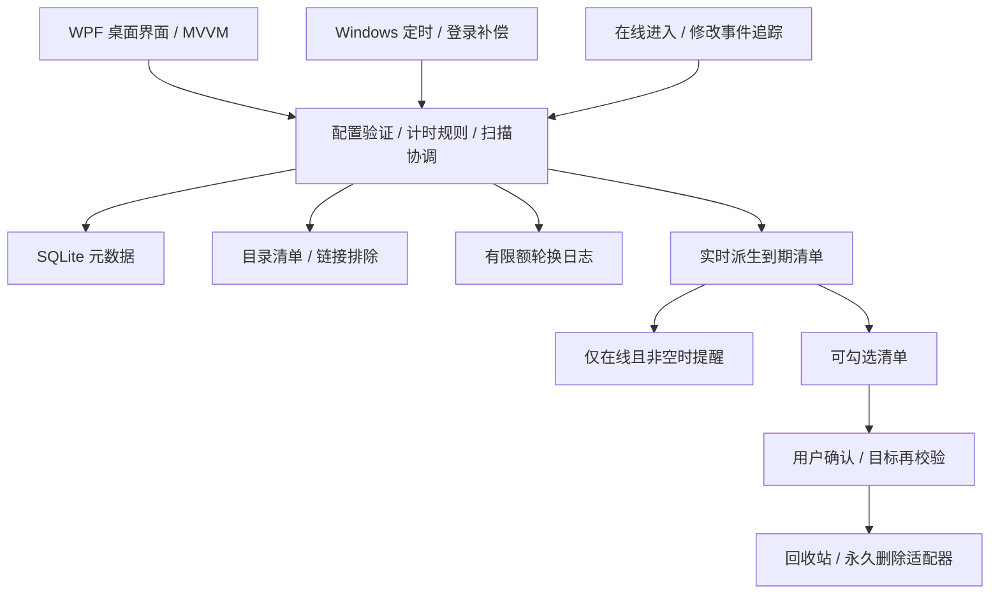

# FolderNest 框架设计

## 选型

正式路线：C# / .NET 10 LTS、WPF、SQLite、Windows Task Scheduler、Windows Shell 回收站、Toast/托盘。以 Windows 10 22H2 / Windows 11 x64 为首个交付平台，最终采用自包含便携 EXE。旧 PowerShell 5.1 + WinForms 留作历史原型，不继续往单脚本堆叠功能。

WPF 有成熟的原生任务栏、DataGrid 编辑/验证/选择机制，适合 Windows 专用小程序；WinUI 3 的发布与系统集成成本较高；Electron 对本地小工具体积较大；Tauri 引入 WebView/Rust 混合栈，目前没有跨平台要求。使用原生 WPF 和轻量 MVVM，不先引入庞大的 UI 框架。

参考产品入口（对话中已有调研方向，不代表本轮重新核验其实现框架）：[DropIt](https://www.dropitproject.com/)、[File Juggler](https://www.filejuggler.com/)、[BleachBit](https://www.bleachbit.org/)。借鉴目录规则、预览和结果日志；“进入时间＋在线确认”按 FolderNest 自身规则实现。

## 模块边界

计时服务不引用桌面 UI 或 Windows API；存储/目录扫描/日志是可替换适配器；清理服务没有自动调度入口。调度器和跟踪器与 GUI 共用核心服务，通过进程锁和 SQLite 事务协调，避免并发写入和重复提醒。

## 代码结构与本轮状态

| 模块 | 本轮已落地 | 待接入 |
|---|---|---|
| `src/FolderNest.Core` | 类型化目录/观察记录、路径校验、到期算法、选择扫描、每日提醒决策 | 调度补偿协调、清理复验流程 |
| `src/FolderNest.Infrastructure` | SQLite 事务存储、目录清单、重解析点排除、轮换日志、便携数据路径、旧任务状态读取 | FileSystemWatcher、任务部署/卸载、Toast、回收站、旧数据导入 |
| `src/FolderNest.Desktop` | 原生 WinExe/图标、WPF 主窗、可校验编辑/天数按钮、Ctrl/Shift 与空白区框选、批量启停/删除监控/扫描、到期预览、任务状态区 | 原尺寸编辑窗、设置页、勾选删除清单、托盘/通知、任务选择部署 |
| `tests/FolderNest.Tests` | 无测试框架依赖的行为回归可执行程序 | 调度/清理/GUI 自动化集成验收 |
| `scripts/build.ps1` | 构建、行为测试、自包含发布、D 盘便携 ZIP | 发布元数据、版本流水线 |

框架预览不会部署新任务，不执行文件删除，也不自动迁移旧配置。界面明确显示“新框架未部署”；可独立查询旧版任务存在状态。提供接口表示后续服务边界，不以空实现宣称功能完成。

## 数据与计时

SQLite `monitors` 存目录配置，`observations` 存首次发现、最近观察到的更新、指纹、大小等元数据；外键删除只清理该目录的记录。不存在永久 Pending 表。到期 = max(首次发现, 最近活动) + 天数，到期清单随当下状态重新计算。

SQLite 使用 WAL、外键和每目录事务；目录枚举完整成功后才替换其记录。停用、非选中目录、访问失败的目录保留历史。空目录成功时清空该目录旧记录。路径编辑时只重置该目录历史，天数/启停/模式编辑不重置。

`FileSystemWatcher` 后续记录在线进入和变化并做防抖；定期完整校正弥补溢出/缺失事件。无法观测的离线进入采用首次发现时刻，避免拿旧修改时间提前删除。指纹包含文件路径/长度/修改时刻，目录指纹包括内部条目；不读取用户文件内容，不跟随链接。

目录访问失败时暂不发该目录的清理授权；最终执行前必须重新验证。单元的删除结果独立记录，某项失败不回滚已经成功进入回收站的其他项。

## 调度设计

新任务名拟用 `FolderNest V2 DailyScan`、`FolderNest V2 OnlineReminder`，与旧版独立。任务关联本地当前用户、绝对 EXE 路径和当前数据位置，启用错过运行补偿；GUI 可选择参与目录和 24 小时时间。

提醒任务只能在交互登录会话中显示通知；每日触发、登录、恢复后统一走提醒策略。持久记录当天提醒尝试日期以去重（不是持久待处理清单）；无到期项目不标记提醒，晚些时候实际出现到期项目仍可提醒。关闭/忽略后不循环追催，下一天重新计算。

如果没有交互用户，扫描结果元数据可保存，但不能弹窗口。机器关机时不执行任何代码；已存截止时间仍推进。重开机时补算一次即可，不为离线每一天伪造扫描日志。

## 便携与历史迁移

正式 EXE 所在目录可移动，数据随便携目录迁移；移动后 GUI 重部署任务更新路径。框架预览数据默认放 EXE 旁 `data-v2/`，不可写时回退 `%LOCALAPPDATA%/FolderNest/v2/` 并在窗口展示。日志仅两份，总计 10 MiB。单文件 EXE 的 .NET/SQLite 原生依赖可能由运行时解压到用户临时缓存，不在那里保存业务配置。

旧 `data/config.json` / `state.json` 在本轮保留。后续只经用户在 GUI 发起导入，验证路径和规则，保留可信 FirstSeen，缺失/无效记录保守重置；不自动复制旧 Pending。导入前保存备份，并检测旧版任务避免两版一起提醒。
